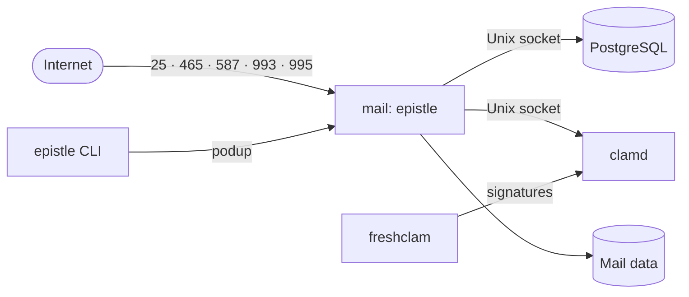

# epistle

A self-hosted mail server for your own domains. epistle runs SMTP, IMAP, POP3
and JMAP with modern email security, on rootless Podman, driven from one CLI.
It has no web interface: you run it through the CLI and its API.

[](https://github.com/Glyndor/epistle/actions/workflows/ci.yml)

## Features

- 📨 **SMTP in and out, submission on 587 and 465**, IMAP4rev2, POP3 and JMAP, plus basic CalDAV and CardDAV.
- 🔏 **SPF, DKIM, DMARC, ARC, MTA-STS and DANE**, with DMARC aggregate reports and automatic DKIM key rotation.
- 🧹 **Sieve filters with ManageSieve**, greylisting, DNSBL, ClamAV, and Bayesian and reputation antispam.
- 👥 **Accounts, aliases, catch-all and masked addresses**, TOTP and app passwords; LDAP, SQL and OIDC directories.
- 🌐 **DNS records published for you** on Cloudflare, Route 53, Google Cloud DNS, DigitalOcean, OVH, GoDaddy, Namecheap, Porkbun, Spaceship, Bunny, deSEC, DNSimple, or your own nameserver over RFC 2136. Certificates through ACME.
- 🔒 **Fails closed**: an unknown config key, broken TLS material or a missing secret stops the server instead of degrading it.

## Install

epistle needs **Podman 5 or newer**, which means Debian 13 or Ubuntu 25.04 and
later, on x86_64 or arm64.

```sh
curl -fsSL https://apt.glyndor.net/install/epistle | sudo sh
sudo epistle init
sudo epistle stack up
```

The installer adds the signed Glyndor apt repository and runs
`sudo apt install epistle`, which brings Podman and podup. `init` writes the
configuration, and `stack up` starts the containers and brings them back after
a reboot. `apt upgrade` keeps the server current.

## Quick start

```sh
sudo epistle stack ps        # the containers and their state
sudo epistle status          # is everything running?
sudo epistle dns-records     # the records to publish for your domains
sudo epistle verify-dns      # check that they are published
sudo epistle account-add --name alice --address alice@example.org   # reads the password from stdin
```

Everything else follows `epistle <resource> <action>`: accounts, aliases,
domains, limits, queue, antispam. [Common tasks](docs/cli.md#common-tasks) maps
what you want to do to the command that does it.

## How it runs



The mail container keeps the real client address. PostgreSQL and clamd have no
network at all and are reached only through Unix sockets.

## Documentation

| Guide | What it covers |
|---|---|
| [CLI reference](docs/cli.md) | Every command, starting with common tasks |
| [Configuration](docs/configuration.md) | The `mail.toml` file, every section and key, secrets |
| [DNS setup](docs/dns.md) | The records to publish and the supported DNS providers |
| [Container stack](docs/container.md) | What `epistle stack` runs and how it is built |
| [Security](docs/security.md) and [threat model](docs/threat-model.md) | The controls, what they protect and what they assume |
| [ASVS mapping](docs/asvs.md) | The controls mapped to OWASP ASVS |
| [Performance](docs/performance.md) | The measured hot paths and how to reproduce them |
| [Contributing](CONTRIBUTING.md) | Building from source, tests and the contribution flow |

## License

[MIT](LICENSE). Report vulnerabilities privately through the **Security** tab,
never in a public issue.
